# AWS 3-Tier Portfolio

Highly available 3-tier architecture on AWS, built entirely with Terraform and checked by a GitHub Actions pipeline that authenticates through OIDC (no access keys).

## Status
- [x] Phase 1: Networking (VPC, 2 AZ, public/app/db subnets, IGW, NAT)
- [x] Phase 2: Security groups, ALB, Auto Scaling (Flask app)
- [x] Phase 2b: RDS MySQL with Secrets Manager
- [x] Phase 3a: CloudWatch alarms and SNS email notifications
- [x] Phase 3b: GitHub Actions CI with OIDC (no access keys)
- [ ] Phase 3c: HTTPS with ACM and Route 53 (optional, needs a domain)
- [ ] Phase 4: Multi-instance failover test and cost estimate

## Architecture
- Region: ap-southeast-1 (Singapore)
- VPC 10.0.0.0/16 across 2 Availability Zones
- Web tier: Application Load Balancer in 2 public subnets
- App tier: Auto Scaling Group (Flask on EC2) in 2 private app subnets
- Data tier: RDS MySQL in 2 private DB subnets with no internet route
- Single NAT Gateway gives app instances outbound internet access
- Layered security groups: ALB (80 from internet) -> App (8080 from ALB only) -> DB (3306 from App only)
- EC2 instances have no public IPs, enforce IMDSv2, and are managed through SSM instead of SSH

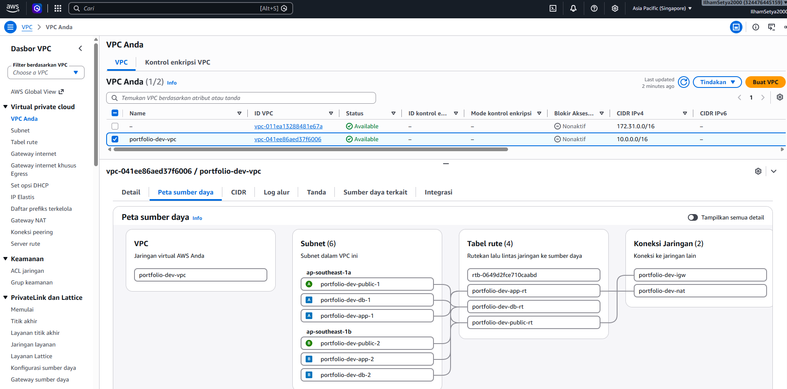
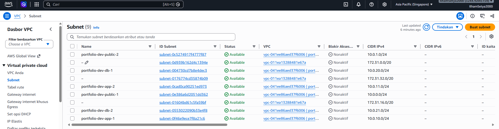
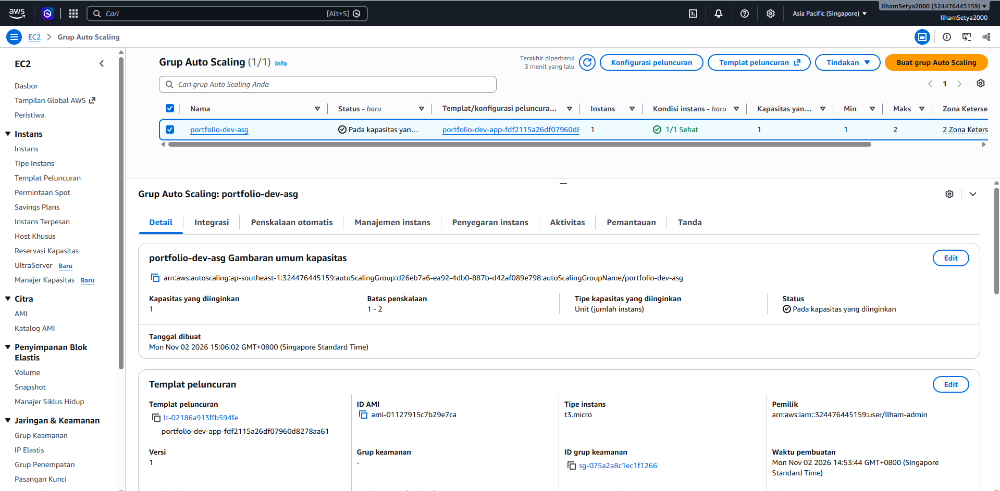

## Database tier (RDS MySQL)
- RDS MySQL in private DB subnets, no public access, encrypted storage
- Master password is generated and stored by AWS Secrets Manager, never written in code
- The app reads the secret at runtime through an IAM role limited to that one secret
- The DB security group accepts port 3306 only from the app security group
- The `/db` endpoint proves the full path: ALB -> EC2 -> Secrets Manager -> RDS

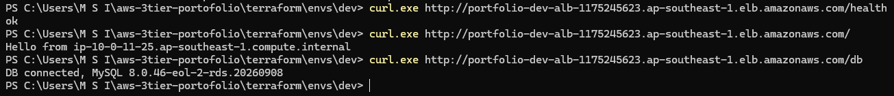
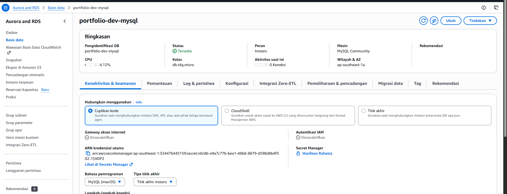
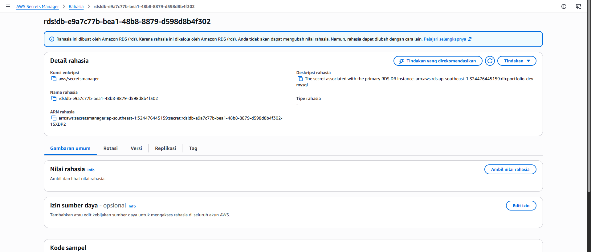
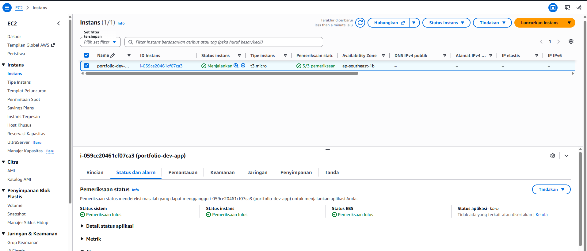

## Monitoring and alerting
- SNS topic with an email subscription receives all alerts
- CloudWatch alarms: unhealthy ALB targets, ALB 5xx errors, high ASG CPU, low RDS free storage
- The unhealthy-targets alarm also notifies on recovery
- Verified end to end by forcing an alarm state and receiving the email

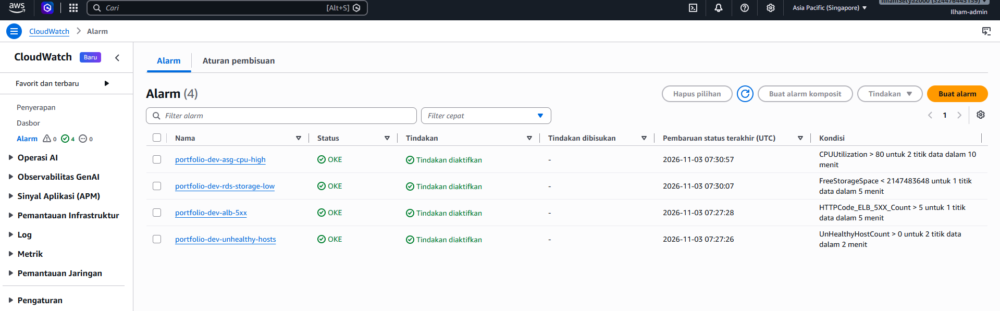
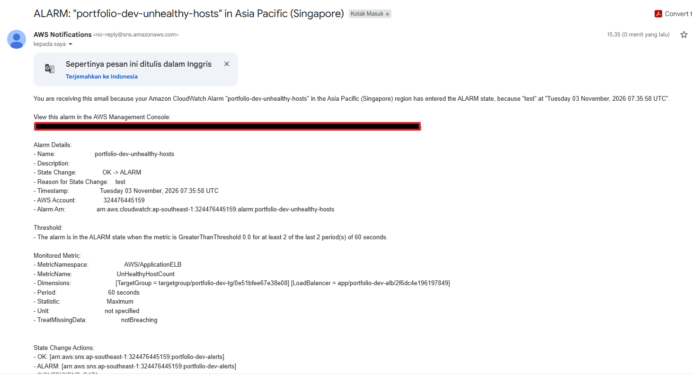

## CI/CD (GitHub Actions with OIDC)
- Workflow runs on every pull request and push to main: `terraform fmt -check`, `init`, `validate`, `plan`
- GitHub authenticates to AWS through OIDC, so there are no long-lived access keys in the repository or in GitHub secrets
- The IAM role trust policy only accepts tokens from this repository (pull requests and the main branch)
- The role has ReadOnlyAccess only, and the pipeline never runs `apply`, so a pipeline mistake cannot create or delete resources
- The OIDC provider and role live in `terraform/bootstrap`, separate from `envs/dev`, so they survive a `terraform destroy` of the environment

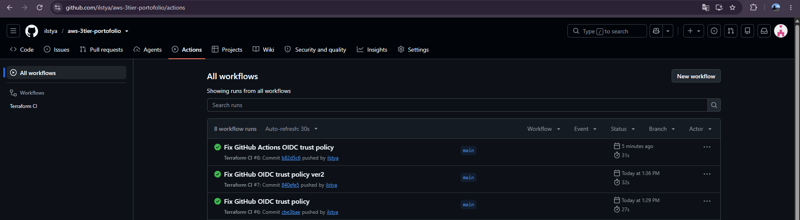
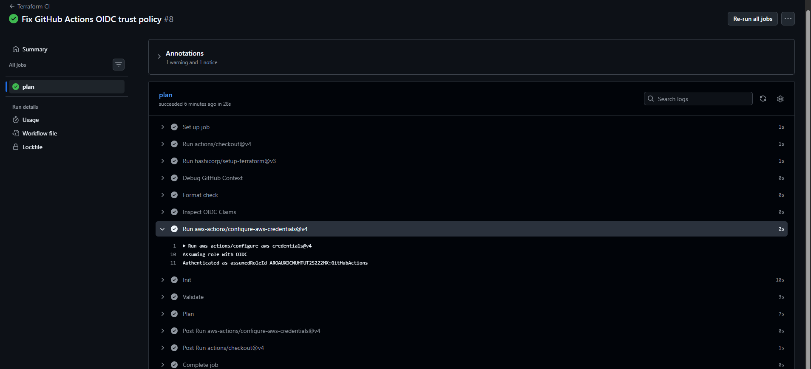

## Failover test (1 instance)
I terminated the only running instance while polling the ALB health endpoint.

- Before: Hello from ip-10-0-10-94
- During: 503 then 502 responses
- After: health check OK again, served by a new instance (ip-10-0-10-57)
- Visible disruption: about 1 minute until Auto Scaling replaced the instance

With a single instance there is a short outage. Phase 4 repeats this test with a minimum of 2 instances across 2 AZs.

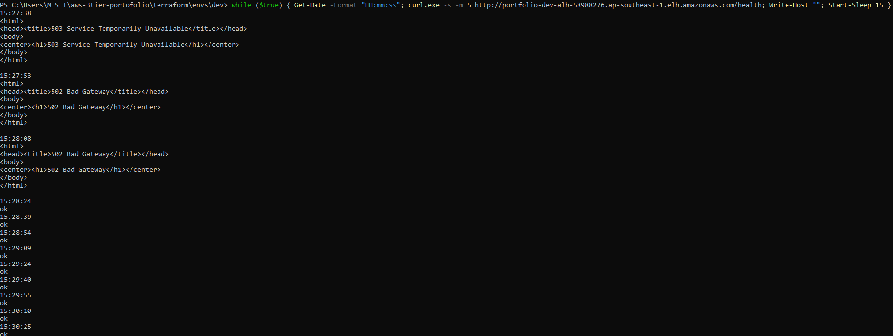

## Tech
Terraform, AWS (VPC, EC2, ALB, Auto Scaling, RDS, Secrets Manager, IAM, CloudWatch, SNS), Python Flask, GitHub Actions (OIDC)

## Project structure
```
terraform/
  bootstrap/ (OIDC provider and CI role)
  modules/ (vpc, security, web, db, monitoring)
  envs/dev/
app/app.py
docs/
.github/workflows/terraform.yml
```

## Deploy
Create `terraform/envs/dev/terraform.tfvars` (not committed) with your email for alerts:
```
alert_email = "you@example.com"
```
Then run:
```
cd terraform/envs/dev
terraform init
terraform plan
terraform apply
terraform destroy   # always destroy after use to avoid NAT, ALB and RDS cost
```
After apply, confirm the SNS subscription email and test with:
```
curl http://<alb_dns>/health
curl http://<alb_dns>/db
```
The CI role in `terraform/bootstrap` is applied once and kept, since it costs nothing.

## Design decisions
- Single NAT Gateway in dev to reduce cost; production would use one per AZ.
- DB subnets have no internet route; the database is reachable only from the app tier.
- Passwords are managed by Secrets Manager, so no credentials live in the repository.
- `/health` does not touch the database, so a DB outage does not make the load balancer kill healthy app instances.
- RDS is single-AZ in dev to save cost; Multi-AZ is planned for the failover phase.
- Terraform state in S3 with versioning and native locking.
- Modular layout (vpc, security, web, db, monitoring) so each tier can change independently.
- Sensitive values such as the alert email live in an uncommitted tfvars file.
- CI is plan-only on purpose: apply is manual because the full stack costs money while running.
- CI uses OIDC with a read-only role scoped to this repository instead of stored access keys.

## Cost note
NAT Gateway, ALB and RDS are billed hourly (roughly US$2.5-3 per day for the full stack). The environment is destroyed after each session.
